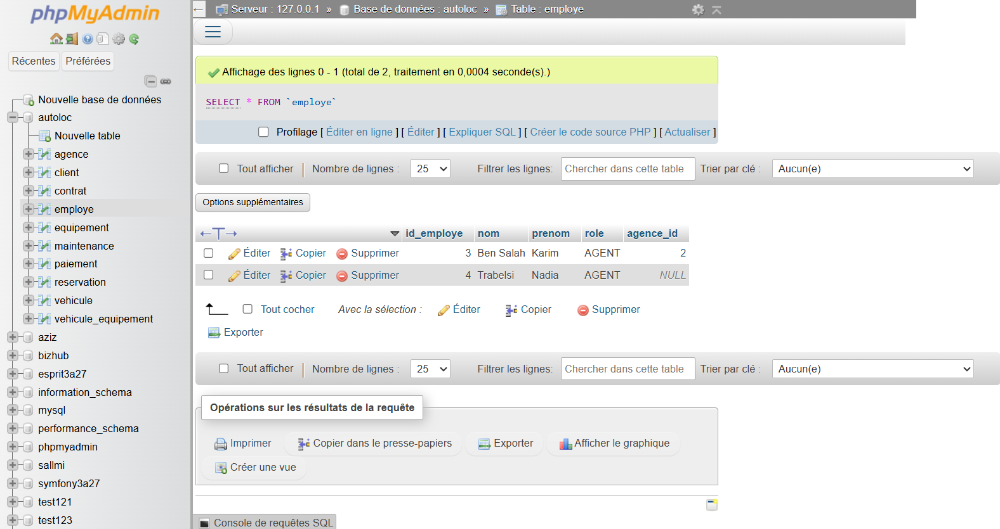
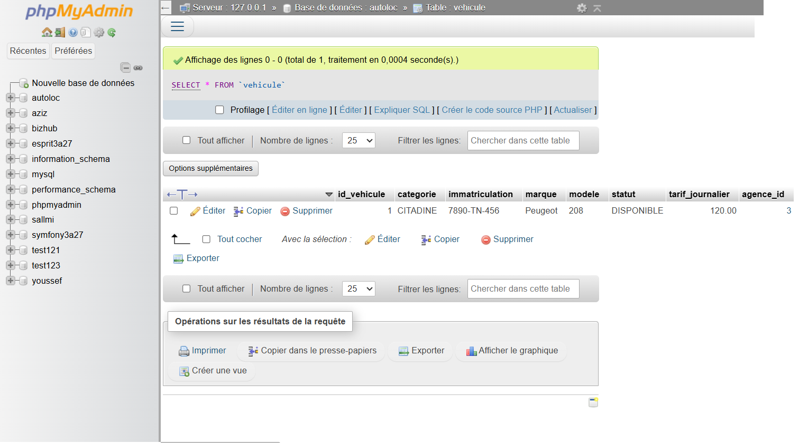
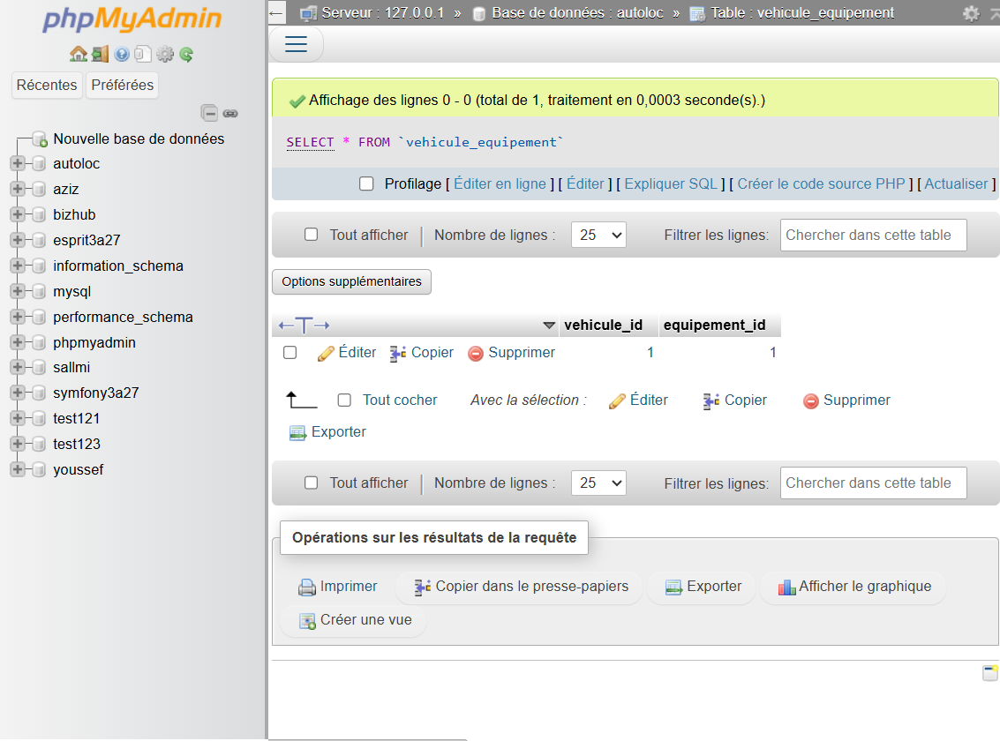

# Atelier 6 — Notes : relations bidirectionnelles (@ManyToOne / @ManyToMany)

Projet : **autoloc-api** (package racine `tn.esprit.autolocn`)
Objectif : gérer les associations bidirectionnelles dans la **couche Service** — affectation et désaffectation — puis vérifier l'état de la base (MySQL/XAMPP) dans **phpMyAdmin**.

---

## A. Les 5 méthodes de l'atelier

| Relation | Méthode (interface) | Rôle |
|---|---|---|
| `@ManyToOne` `Employe.agence` | `IEmployeService.affecterEmploye(idEmploye, idAgence)` | Affecte l'employé à une agence ; si déjà affecté ailleurs → **transfert** (désaffecter puis affecter) |
| `@ManyToOne` `Employe.agence` | `IEmployeService.desaffecterEmploye(idEmploye)` | Retire l'employé de son agence : l'employé **subsiste**, `agence_id = NULL` |
| `@ManyToOne` `Vehicule.agence` | `IVehiculeService.affecterVehicule(idVehicule, idAgence)` | Rattache un véhicule à son agence (véhicule neuf → Sfax) |
| `@ManyToMany` `Vehicule.equipements` | `IVehiculeService.affecterEquipement(idVehicule, idEquipement)` | Installe un équipement sur le véhicule → ligne insérée dans `vehicule_equipement` |
| `@ManyToMany` `Vehicule.equipements` | `IVehiculeService.desaffecterEquipement(idVehicule, idEquipement)` | Retire l'équipement → ligne supprimée de `vehicule_equipement` |

Implémentations : `EmployeServiceImpl` et `VehiculeServiceImpl` — chaque méthode est `@Transactional` (elle touche **deux** entités : elle doit être atomique) et gère les **deux côtés** de la relation.

## B. Côté propriétaire vs côté inverse — qui persiste quoi ?

- **`@ManyToOne`** : le côté propriétaire est l'entité **enfant** (`Employe.agence` / `Vehicule.agence`), qui porte le `@JoinColumn(name = "agence_id")`. C'est **elle qu'il faut sauvegarder** pour persister l'affectation (UPDATE de la clé étrangère).
- **`@ManyToMany`** : le côté propriétaire est celui qui porte le `@JoinTable` — ici `Vehicule.equipements` (table associative `vehicule_equipement`). `Equipement.vehicules` (`mappedBy`) n'est qu'une vue en mémoire : le sauvegarder ne change rien en base.
- Le côté inverse est toujours mis à jour **en mémoire** (cohérence de la session) — les deux listes doivent refléter la même réalité.

## C. Scénarios exécutés (démo `Atelier6Demo`)

Activation : `mvn spring-boot:run "-Dspring-boot.run.arguments=--autoloc.atelier6.demo=true"`
(le runner est conditionné par `@ConditionalOnProperty(name = "autoloc.atelier6.demo")` — inactif par défaut, données **idempotentes**).

| Scénario | Opération | Trace SQL | Résultat (logs) |
|---|---|---|---|
| 1 | `affecterEmploye(Ben Salah, Tunis)` | `UPDATE employe SET agence_id=1 …` | employé 3 → Agence Tunis Centre |
| 1 (transfert) | `affecterEmploye(Ben Salah, Sousse)` | `UPDATE employe SET agence_id=2 …` | employé 3 → Agence Sousse Médina |
| 1 (désaffect.) | `desaffecterEmploye(Trabelsi)` | `UPDATE employe SET agence_id=NULL …` | employé 4 → agence = NULL |
| 2 | `affecterVehicule(7890-TN-456, Sfax)` | `UPDATE vehicule SET agence_id=3 …` | véhicule 1 → Agence Sfax Corniche |
| 3 | `affecterEquipement(v1, siège bébé)` | `INSERT INTO vehicule_equipement …` | siège bébé (id 1) monté |
| 3 (retrait) | `affecterEquipement(v1, GPS)` puis `desaffecterEquipement(v1, GPS)` | `INSERT` puis `DELETE FROM vehicule_equipement …` | GPS (id 2) démonté |

Vérification finale (associations LAZY relues dans une session) :

```
[Vérif] Employé 3 (Ben Salah) rattaché à l'agence : Agence Sousse Médina (Sousse)
[Vérif] Employé 4 (Trabelsi) rattaché à l'agence : NULL
[Vérif] Véhicule 1 (7890-TN-456) : agence = Agence Sfax Corniche (Sfax), équipements = [Siège bébé]
```

## D. Piège `orphanRemoval` (constaté puis corrigé)

**Première version (buggée)** — le transfert retirait l'employé de la liste de l'ancienne agence :

```java
agenceActuelle.getEmployes().remove(employe);  // ← PIÈGE
employe.setAgence(null);
employeRepository.save(employe);
```

**Traces SQL observées** : `DELETE FROM employe WHERE id_employe=?` — l'employé a été **supprimé de la base** au flush (crash en vérification finale : `NoSuchElementException`) !

**Cause** : `Agence.employes` est annoté `cascade = ALL, orphanRemoval = true`. L'agence est une entité **gérée** dans la transaction : dès qu'une de ses collections est sale (retrait d'un élément), Hibernate la flushe automatiquement **même sans `save()` explicite de l'agence** → l'enfant retiré est traité comme un **orphelin** et supprimé.

**Correction** — ne jamais toucher à la liste de l'ancienne agence ; seule la clé étrangère change :

```java
employe.setAgence(null);          // côté propriétaire UNIQUEMENT
employeRepository.save(employe);  // UPDATE agence_id = NULL (pas de DELETE)
...
employe.setAgence(nouvelleAgence);   // transfert : simple réaffectation de la FK
agence.getEmployes().add(employe);   // côté inverse de la NOUVELLE agence (ajout, sans danger)
```

> Règle retenue : avec `orphanRemoval = true`, **retirer un enfant de la collection du parent = le supprimer**. Désaffecter ≠ supprimer : on ne modifie que le côté propriétaire (`agence_id`). Le `@ManyToMany` (`vehicule_equipement`) n'a pas ce piège : retirer un élément du `Set` supprime la ligne de la table associative, pas l'équipement.

## E. Captures phpMyAdmin (vérification en base)

Base `autoloc` (XAMPP/MySQL), affichées via `http://localhost/phpmyadmin`.

### 1. Table `employe` — transfert (S1) et désaffectation (S1 bis)



- Ligne `3 | Ben Salah | Karim | AGENT | 2` : transféré de Tunis (1) vers **Sousse (2)** — la ligne existe toujours (désaffecter/supprimer ≠ supprimer).
- Ligne `4 | Trabelsi | Nadia | AGENT | NULL` : **désaffectée** — `agence_id` à NULL, toujours présente dans la table.

### 2. Table `vehicule` — rattachement à Sfax (S2)



- Ligne `1 | CITADINE | 7890-TN-456 | Peugeot | 208 | DISPONIBLE | 120.00 | 3` : le véhicule neuf est rattaché à l'**agence 3 (Sfax)**.

### 3. Table associative `vehicule_equipement` — siège bébé monté, GPS retiré (S3)



- Une seule ligne : `(vehicule_id=1, equipement_id=1)` — le **siège bébé** est monté ; le **GPS** (id 2), monté puis retiré, ne laisse **aucune trace** (DELETE de la ligne associative, pas de l'équipement lui-même).

## Vérifications finales

- [x] `IEmployeService` / `IVehiculeService` : 5 méthodes d'affectation/désaffectation déclarées
- [x] Implémentations `@Transactional` — gestion des deux côtés (propriétaire + inverse)
- [x] Piège `orphanRemoval` constaté (DELETE observé) puis corrigé (UPDATE uniquement)
- [x] Démo `Atelier6Demo` exécutée sans erreur (3 scénarios + vérifications finales)
- [x] Vérification en base via MySQL : `employe` (agence_id 2 / NULL), `vehicule` (agence_id 3), `vehicule_equipement` (1,1)
- [x] Captures phpMyAdmin déposées dans `docs/images/` (3 captures)

## Livrables

- [x] 5 méthodes dans la couche Service (`@ManyToOne` ×3, `@ManyToMany` ×2)
- [x] Runner de démonstration `Atelier6Demo` (activation `--autoloc.atelier6.demo=true`, idempotent)
- [x] Captures d'écran des sorties phpMyAdmin (`docs/images/atelier6-*.png`)
- [x] Note `docs/associations-notes.md` — commit et push sur le dépôt Git « AutoLoc »
